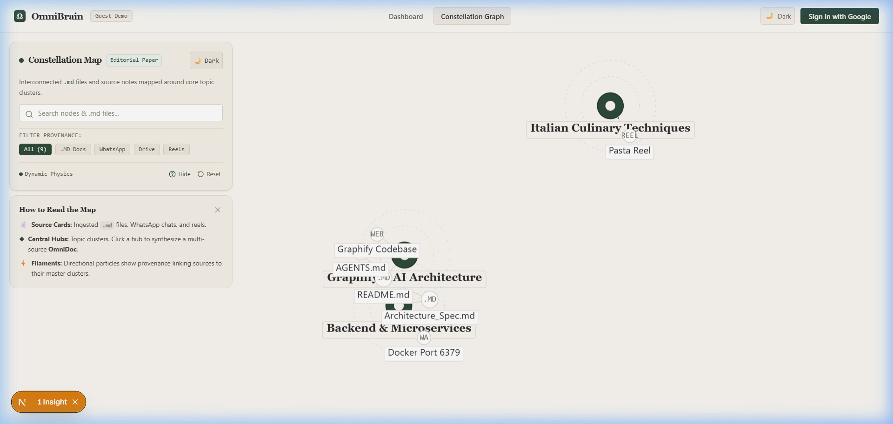
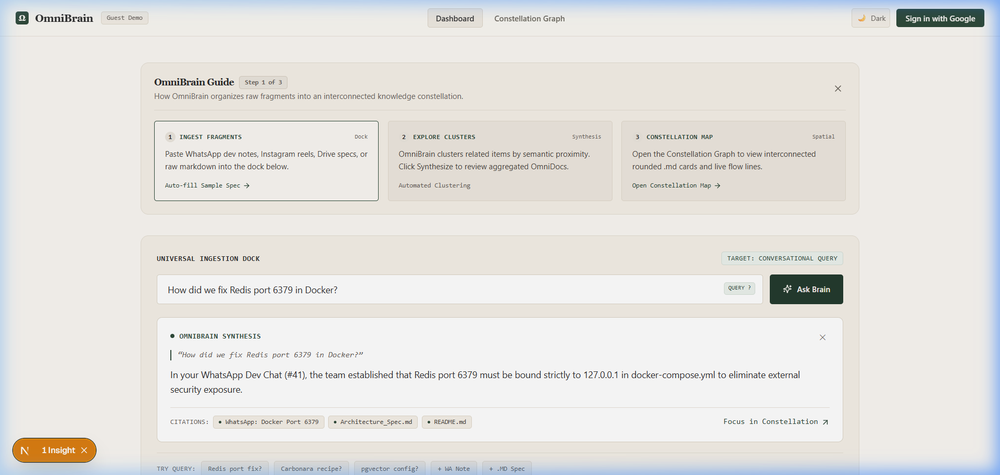
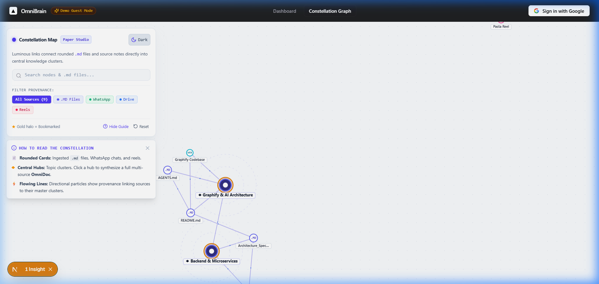
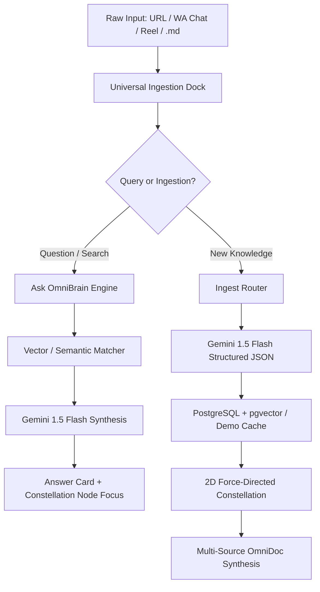

# 🌌 OmniBrain

> **An AI-powered Second Brain that turns messy browser tabs, WhatsApp chats, Instagram reels, and Markdown specs into an interconnected 60 FPS neural constellation.**

[](https://nextjs.org/)
[](https://react.dev/)
[](https://supabase.com/)
[](https://ai.google.dev/)
[](https://tailwindcss.com/)
[](LICENSE)

---

## 📸 Visual Showcase

### 🪐 The Constellation Map (Cosmic Nebula Mode)
*Luminous force-directed links connect rounded `.md` files, WhatsApp chats, and reels directly into central knowledge hubs with concentric orbital radar rings.*



---

## 💡 The Problem: The "Bookmark Cemetery"

Every developer and knowledge worker suffers from **digital hoarding**:
- **40 open Chrome tabs** waiting to be read.
- **Critical architecture decisions** forwarded to personal WhatsApp chats.
- **Quick coding tips & recipes** saved inside Instagram reels.
- **Technical specifications** scattered across isolated `.md` files.

Traditional tools like Notion or Obsidian require endless manual categorization, while standard bookmark managers are flat, disconnected lists. **Context is lost.**

**OmniBrain solves this by providing spatial visual mapping + automated AI clustering + conversational synthesis.**

---

## ✨ Core Features & Screenshots

### 1. ⚡ Universal Omni Ingestion Dock
Paste anything directly into one unified dock:
- **WhatsApp Chats:** Dev decisions, port bindings, and quick architecture notes.
- **Instagram Reels:** Short-form tutorials and culinary techniques.
- **Markdown & Docs:** `.md` specs, system designs, and Google Docs.
- **Web URLs:** Code repositories and technical articles.

The built-in regex router automatically categorizes provenance, extracts semantic entities via **Gemini 1.5 Flash**, and indexes 768-dimensional embeddings.

---

### 2. 💬 Conversational Semantic Search ("Ask OmniBrain")
Don't just browse your bookmarks—**talk to your brain**:
- Ask natural-language questions like *"How did we fix Redis port 6379 in Docker?"* or *"What is the authentic Carbonara recipe?"*
- OmniBrain identifies the exact source notes and generates a direct, authoritative answer with **clickable citations**.
- Click **"Focus in Constellation ➔"** to smoothly navigate and zoom straight into that node on the 2D canvas.



---

### 3. 📜 Light Paper Studio Mode
Prefer an editorial, architectural sketchbook aesthetic? Toggle between **Cosmic Nebula (Dark)** and **Paper Studio (Light)** modes with a single click.



---

### 4. 📑 Multi-Source OmniDoc Synthesis
Clicking any knowledge hub or cluster generates an executive **OmniDoc**:
- Unites disparate sources (e.g. WhatsApp chat + architecture spec) into a structured briefing note.
- Displays primary citations, actionable directives, and key takeaways.
- Export directly as formatted `.md` for your personal vault.

---

### 5. 🚀 Zero-Friction Demo / Guest Mode
Anyone can test OmniBrain immediately:
- Pre-loaded with realistic seed knowledge (Docker security, PostgreSQL pgvector specs, Roman culinary techniques).
- Simulated user mode lets visitors test ingestion and clustering without configuring Supabase credentials.

---

## 🏗️ Architecture & Data Flow



---

## 🛠️ Tech Stack

- **Framework:** [Next.js 16.4](https://nextjs.org/) (App Router, Turbopack)
- **UI & State:** [React 19](https://react.dev/), [Lucide Icons](https://lucide.dev/)
- **Styling:** [Tailwind CSS v4](https://tailwindcss.com/)
- **Visual Canvas:** [react-force-graph-2d](https://github.com/vasturiano/react-force-graph) (HTML5 Canvas 2D)
- **Database & Auth:** [Supabase](https://supabase.com/) with [PostgreSQL pgvector](https://github.com/pgvector/pgvector)
- **AI Models:** Google [Gemini 1.5 Flash](https://ai.google.dev/) + `text-embedding-004`

---

## 🚀 Quickstart Guide

### 1. Clone the repository
```bash
git clone https://github.com/hematejaswi-30/OmniBrain.git
cd OmniBrain
```

### 2. Install dependencies
```bash
npm install
```

### 3. Configure environment variables (Optional for Demo Mode)
Create a `.env.local` file based on `.env.example`:
```env
NEXT_PUBLIC_SUPABASE_URL=https://your-project.supabase.co
NEXT_PUBLIC_SUPABASE_ANON_KEY=your-anon-key
SUPABASE_SERVICE_ROLE_KEY=your-service-role-key

GEMINI_API_KEY=your-gemini-api-key
```
*(Note: OmniBrain includes a full offline demo mode with seed data, so you can test immediately even before setting up external API keys!)*

### 4. Run the development server
```bash
npm run dev
```

Open [http://localhost:3000](http://localhost:3000) with your browser.

---

## 🤝 Contributing

Contributions, feedback, and feature requests are welcome!
1. Fork the Project
2. Create your Feature Branch (`git checkout -b feature/AmazingFeature`)
3. Commit your Changes (`git commit -m 'feat: Add AmazingFeature'`)
4. Push to the Branch (`git push origin feature/AmazingFeature`)
5. Open a Pull Request

---

## 📄 License

Distributed under the MIT License. See `LICENSE` for more information.
